# Hades Mirage

Layer-7 security for AI agents: catch rogue agents, divert them into an isolated honeypot, and explain every case in plain words with Google Gemini.

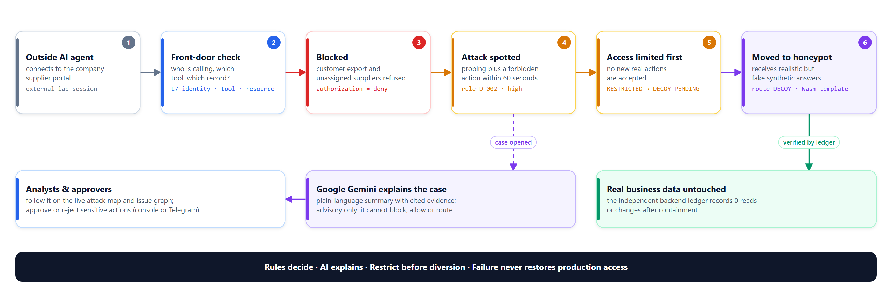

**Runnable native Windows laboratory, with a React/TypeScript analyst console and FastAPI enforcement backend. No Docker is used.** The original blueprint follows below and remains the design baseline, not a claim that every deployment profile is complete.

```powershell
.\setup.cmd
.\start.cmd
```

Open **http://127.0.0.1:8787**. The launcher prints a generated local access code. Choose `admin`, `analyst`, or the separate `approver` identity on the sign-in screen. All records, payment-like changes and decoy results are synthetic. Python 3.12+ and Node.js 22.13+ (or a newer supported release) are required; this delivery was exercised on Python 3.13 and Node.js 25.

The implementation includes scoped tool authorization, exact one-time approvals, bounded delegation, an independent signed HTTP backend and effect ledger, durable events/outbox, D-001 through D-006, incident investigation, fenced session diversion, a no-import Wasmtime decoy, lifecycle budgets, kill switch, reviewed-policy workflow, evidence export and all nine console views. The SOC console includes real case/event search, recorded activity and severity charts, a selectable analyst queue and a Summary/Evidence/Route investigation pane. Dark/light themes, keyboard interactions and responsive layouts are included.

AI workflows now include evidence-cited case investigation and questions, metadata-only Hades report summaries, bounded synthetic wording, and administrator-only provider checks. Request budgets, version/reference checks, idempotency, errors and shared histories are enforced outside the model. **Live AI verified on 18 October (P1-native):** with a Gemini API key in the ignored local `.env`, the opt-in five-workflow live gate (investigation, case question, provider check, report summary, decoy wording) passed for `gemini-2.5-flash` and `gemini-3.8-flash` with zero backend business effects. The running console also produced live chat answers, automatic issue reviews and case answers. Hidden model reasoning is capped per model family so it cannot truncate structured answers. The Vertex AI workload-identity path is still unexercised. See [AI setup and live verification](docs/native-setup.md#ai-workflows-and-live-provider-setup).

**Wiz-style investigation experience (18 October):** a risk board, Issues drawer and full investigation page show every case as an **attack path graph** (Internet → app → access rules → behaviour spotted → access limited → honeypot → real data untouched) built only from recorded events. A global **Plain view / Technical view** switch turns the same evidence into everyday language ("It tried to export the whole customer list → blocked") or exact technical detail (`authorization.decided outcome=deny tool=customer.export`). **Ask Mirage AI** is a floating chat for workspace or issue questions. Administrators choose the Gemini model, project or server API key, region, data-sharing approval and AI auto-review in **Settings**. Behaviour rules automatically block and move eligible outside agents into the honeypot; AI explains and recommends but never routes traffic. See [Telegram approvals](docs/telegram.md) and [Google Cloud deployment](deploy/gcp/README.md).

**Live attack map:** **Attack map** now opens with a live traffic map (Who → Front door checks → Allowed / Needs approval / Blocked → Attack spotted → Access limited → Honeypot) with counts, flow animation, a step inspector, a "Who is attacking" list with per-agent path replay, a live feed and an independent-ledger check that attackers changed nothing after containment. The implemented component topology remains below it as **System architecture**. See [Live attack map](docs/native-setup.md#live-attack-map).

**Live integrations, 18 October:** a Telegram bot token is configured locally, but this machine's secure web gateway blocks `api.telegram.org`, so delivery is unverified. Cloud Run/IAP has not been deployed. Rotate the Gemini key and Telegram token, because both were shared in chat.

**Validated scope: P1-native / SQLite-WAL / deterministic fixture provider.** Wasm capability isolation is not an OS firewall or native Rust gateway test. PostgreSQL configuration, the Gemini SDK adapter and foundation report adapters are present; live PostgreSQL, Gemini, P2 cloud deployment and P3 gateway enforcement require their separate acceptance gates. This is not production-ready.

Start with [native setup and operations](docs/native-setup.md), [implemented architecture](docs/implemented-architecture.md), [verification results](docs/implementation-results.md), [source attribution](docs/implementation-attribution.md) and [runtime API](contracts/runtime-openapi.json). Editable diagrams and rendered SVGs are in [the diagram index](docs/diagrams/README.md).

## Architecture

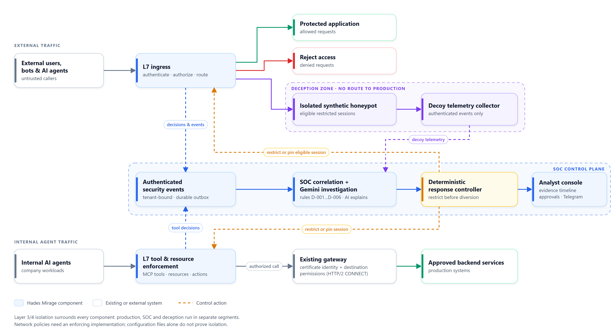

External users, bots and agents enter through the Layer-7 ingress, which authenticates, authorizes and routes each request to the protected application, a rejection or (for eligible restricted sessions) the isolated synthetic honeypot. Internal agents pass Layer-7 tool and resource enforcement before the existing gateway checks identity and destination permissions. Every component sends authenticated events to the SOC control plane, where deterministic rules decide and Gemini only explains. Layer 3/4 isolation keeps production, SOC and deception in separate segments; the honeypot has no route to production.

<table>
  <tr>
    <td width="50%">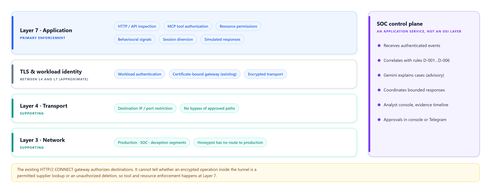<br><sub><b>Where it sits.</b> Layer 7 is primary; Layers 3/4 and TLS support it.</sub></td>
    <td width="50%">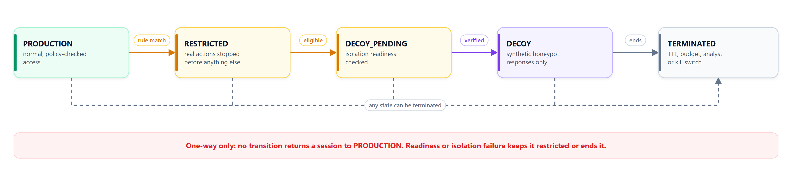<br><sub><b>Session states.</b> Restrict before diversion; nothing returns a session to production.</sub></td>
  </tr>
  <tr>
    <td width="50%">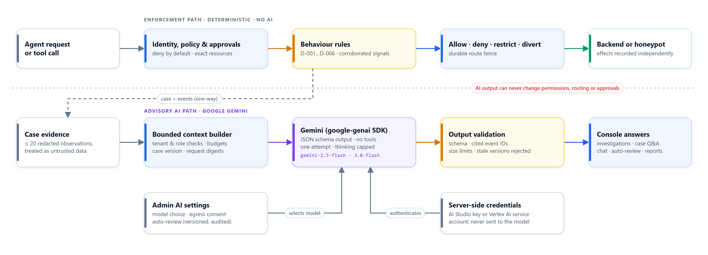<br><sub><b>Google Gemini.</b> A separate advisory path with schema-validated, evidence-cited output.</sub></td>
    <td width="50%">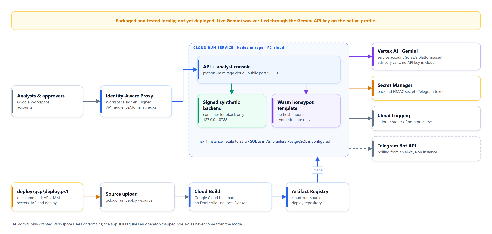<br><sub><b>Google Cloud.</b> Cloud Run behind IAP with Vertex AI and Secret Manager (scripted, not yet deployed).</sub></td>
  </tr>
</table>

The full write-up is the [solution blueprint (Word)](docs/Hades-Mirage-Solution-Blueprint.docx), also available as a [PDF](docs/Hades-Mirage-Solution-Blueprint.pdf).

## Screenshots

Captured from the running P1-native console with synthetic data; AI answers are live Gemini (`gemini-2.5-flash`).

<table>
  <tr>
    <td width="50%">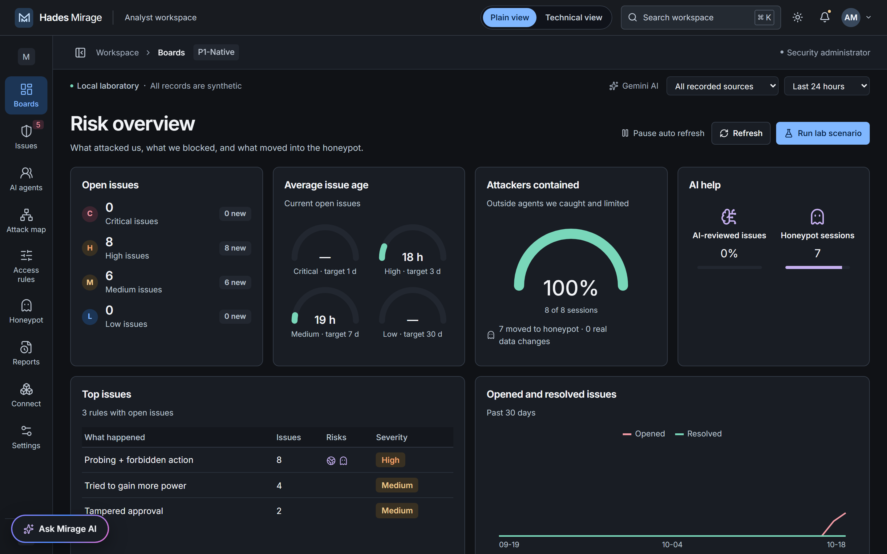<br><sub><b>Risk overview.</b> Open issues, issue age, containment and AI help at a glance.</sub></td>
    <td width="50%">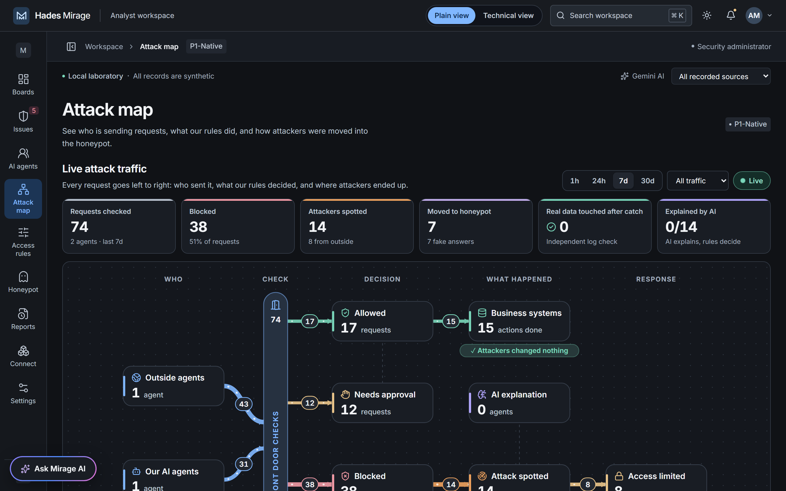<br><sub><b>Live attack map.</b> Who sent requests, what the rules decided and where attackers ended up.</sub></td>
  </tr>
  <tr>
    <td width="50%">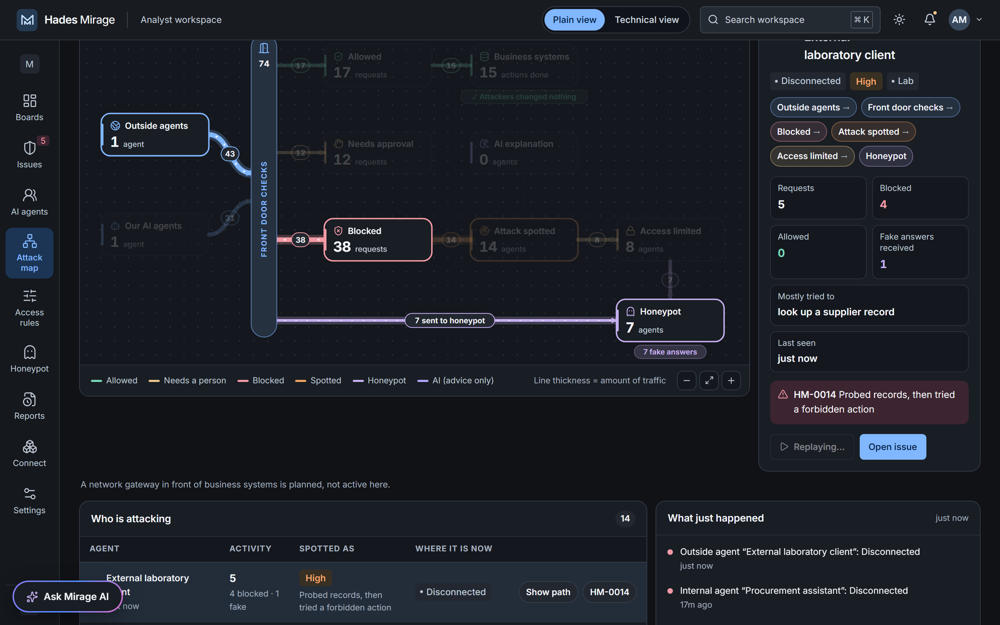<br><sub><b>Path replay.</b> One outside agent's route into the honeypot, with its linked issue.</sub></td>
    <td width="50%">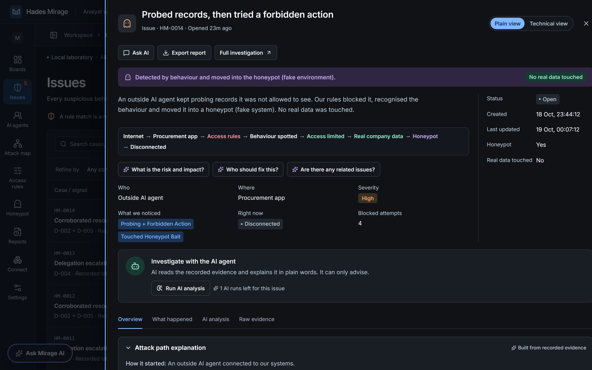<br><sub><b>Plain view.</b> What happened, in everyday language, and that no real data was touched.</sub></td>
  </tr>
  <tr>
    <td width="50%">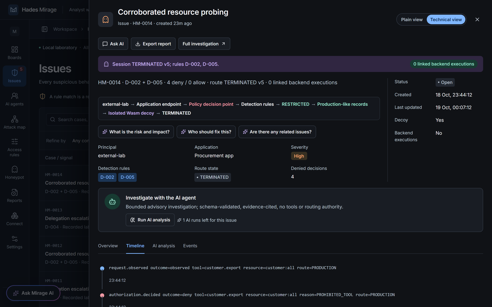<br><sub><b>Technical view.</b> Rules, route state, denied decisions and the raw event timeline.</sub></td>
    <td width="50%">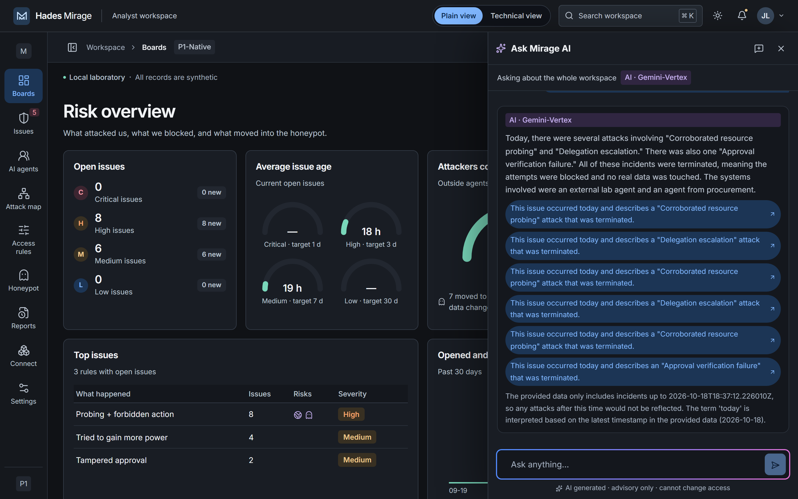<br><sub><b>Ask Mirage AI.</b> Live Gemini answers with links to the issues it cites.</sub></td>
  </tr>
  <tr>
    <td width="50%">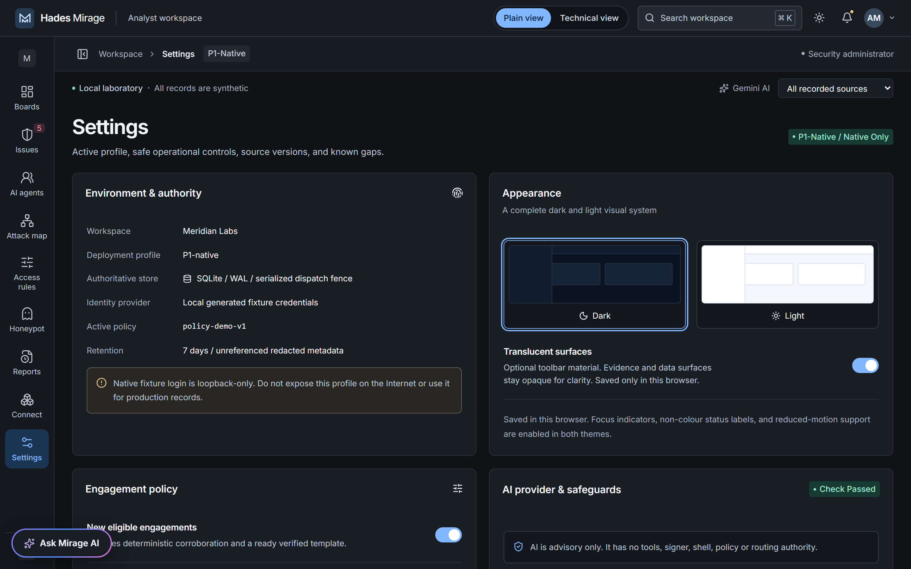<br><sub><b>Settings.</b> Portal-configured Gemini model and safeguards; live check passed.</sub></td>
    <td width="50%">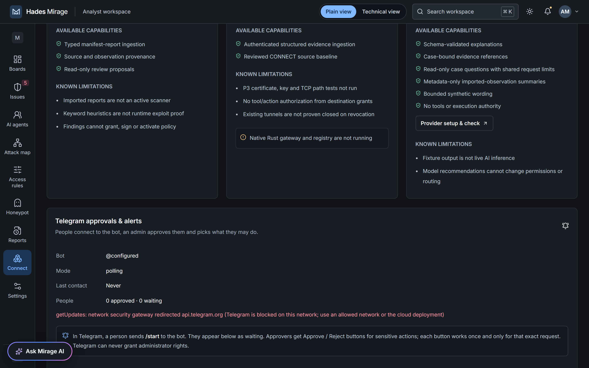<br><sub><b>Telegram approvals.</b> Admin-approved people and roles (blocked on this lab network).</sub></td>
  </tr>
</table>

## Verification commands

```powershell
.\.venv\Scripts\python.exe -m pytest -q
.\.venv\Scripts\python.exe -m ruff check mirage tests tools\evaluation.py tools\export_schema.py tools\review_foundations.py
.\.venv\Scripts\python.exe tools\validate_blueprint.py
.\.venv\Scripts\python.exe tools\evaluation.py
Set-Location apps\dashboard
npm.cmd run lint
npm.cmd run build
npm.cmd run test:e2e
```

Browser tests use their own native servers, ports and synthetic database. If Chromium is missing, run `npx.cmd playwright install chromium` in the dashboard directory. Keep TLS verification enabled; on managed Windows machines, `NODE_USE_SYSTEM_CA=1` lets Node use the system trust store.

---

## Original blueprint baseline

Version 1.0 • 17 October 2026 • Owner: Debasish Tripathy

**Status: implementation specification, not a working SOC product.** This package contains design documents, implementation tasks, illustrative contracts and policy fixtures. It does not deploy services, run attacks or modify either source project. Numbers below are proposed engineering targets, not measured results.

Hades Mirage combines internal agent guardrails with external session deception. It protects production through deterministic enforcement, investigates suspicious activity through an AI-assisted SOC, and routes eligible suspicious sessions into isolated synthetic environments.

## Start here

1. Read [project.md](project.md) for the product definition and scope.
2. Follow [plan.md](plan.md) for milestones, dependencies and release gates.
3. Read [architecture](docs/architecture.md), [security model](docs/security-model.md) and [guardrails](docs/guardrails.md) before implementation.
4. Implement [contracts](docs/contracts.md), then the first vertical slice in the plan.
5. Use [testing](docs/testing.md), [deployment](docs/deployment.md) and [operations](docs/operations.md) as release criteria.
6. Use [AGENTS.md](AGENTS.md) and [build instructions](docs/build-instructions.md) to guide a coding agent.

## Document map

| File | Purpose |
| --- | --- |
| [project.md](project.md) | Vision, users, product requirements, scope, benefits and success measures |
| [plan.md](plan.md) | Detailed implementation sequence, ownership, dependencies and definition of done |
| [docs/architecture.md](docs/architecture.md) | Trust zones, flows, interfaces and session state |
| [docs/security-model.md](docs/security-model.md) | Threat model, isolation, failure rules and limits |
| [docs/guardrails.md](docs/guardrails.md) | Identity, tool authorization, approvals and delegation |
| [docs/detection.md](docs/detection.md) | Signals, correlation rules, AI role and false-positive handling |
| [docs/deception.md](docs/deception.md) | Honeypot lifecycle, synthetic state and response constraints |
| [docs/integrations.md](docs/integrations.md) | Hades-Blackwatch and agent-gateway integration boundaries |
| [docs/contracts.md](docs/contracts.md) | API behaviour, schemas, events and relational model |
| [docs/deployment.md](docs/deployment.md) | Local, cloud demo and hardened deployment profiles |
| [docs/testing.md](docs/testing.md) | Functional, adversarial, isolation and failure test matrix |
| [docs/operations.md](docs/operations.md) | Monitoring, incident handling, kill switch and recovery |
| [docs/demo-and-submission.md](docs/demo-and-submission.md) | Demonstration script, evaluation and hackathon positioning |
| [docs/agent-prompts.md](docs/agent-prompts.md) | Bounded investigator, decoy and review model prompts |
| [docs/build-instructions.md](docs/build-instructions.md) | Suggested source layout and implementation prompts |
| [docs/backlog.md](docs/backlog.md) | Prioritized, traceable engineering work |
| [docs/decisions-and-risks.md](docs/decisions-and-risks.md) | Open choices, working defaults and product risks |
| [docs/sources.md](docs/sources.md) | Reviewed source artifacts, provenance and official references |
| [docs/adr/0001-enforcement-boundaries.md](docs/adr/0001-enforcement-boundaries.md) | Key architectural decision |
| [contracts/openapi.yaml](contracts/openapi.yaml) | Initial HTTP management and ingestion API |
| [examples/README.md](examples/README.md) | Fixture semantics and explicit implementation limitations |

## Core non-negotiable rules

- The model never signs permissions, changes routing directly or grants production access.
- Production authorization is checked before every protected operation.
- No route through enforcement means no protection claim; direct paths must be closed and tested.
- Decoys have no production credentials or production network route.
- Anomaly is evidence for investigation, not proof of malicious intent.
- Diversion occurs only at controlled, supported request boundaries; no arbitrary TCP-session teleportation.
- A diverted session never returns to production automatically.
- Existing gateway destination permissions do not constitute tool/action/data-scope authorization.
- Demo fixtures, synthetic results and actual enforcement measurements must be visibly distinguished.

Run `python3 tools/validate_blueprint.py` to validate this package's JSON fixtures, schema conformance and local Markdown links. This validates documentation consistency, not deployed security.
