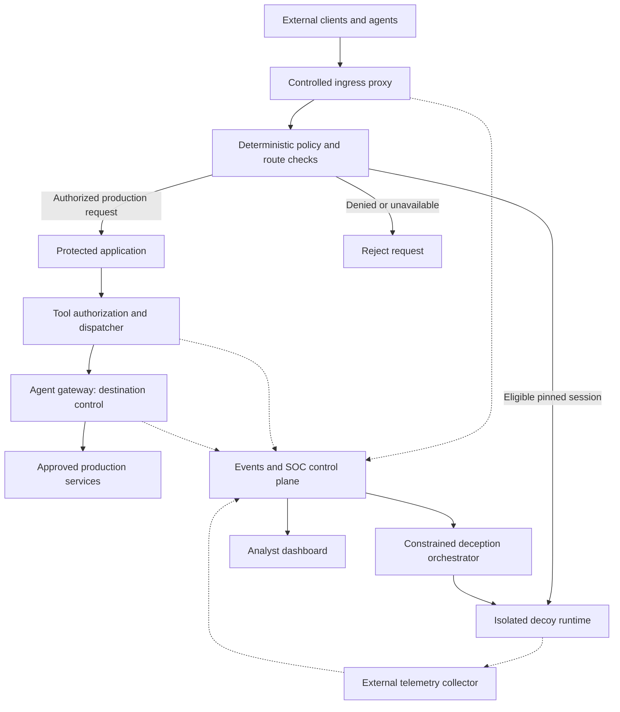
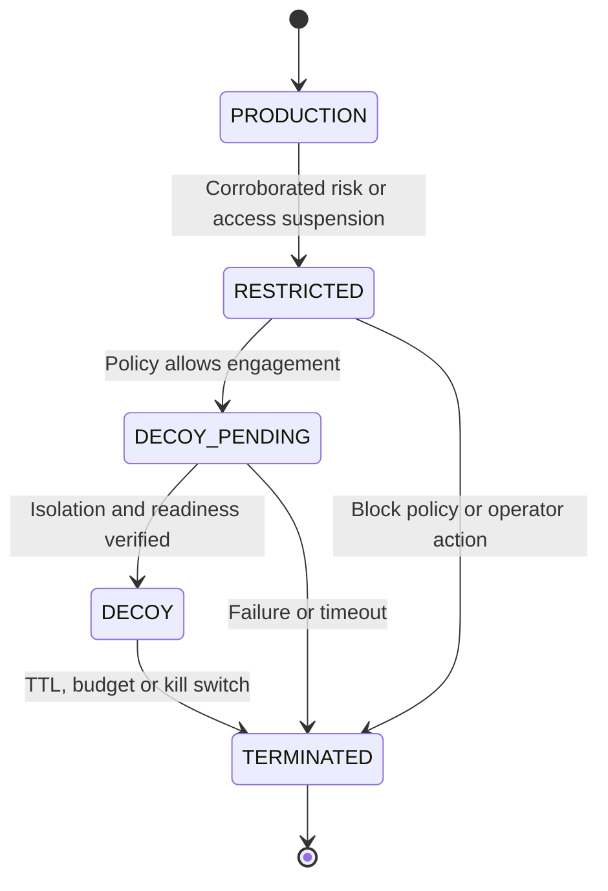

# Architecture

## 1. Trust zones and components

Dotted edges are telemetry, not automatic authorization. Diagram is the target design; gateway routing applies to the dedicated enforcement profile. Local/cloud-only demonstrations must identify which edges are real.

### Zone A: edge

Ingress terminates external application TLS, validates sessions and strips spoofed identity/routing headers. Only configured application routes are supported. It does not accept arbitrary target URLs. Application origins are reachable only through approved service identities and paths.

### Zone B: protected workloads

Internal agents invoke typed tools through the dispatcher. A workload identity is distinct from the human on whose behalf it acts. Both scopes constrain authority. Tool credentials are held by the dispatcher; the agent never obtains broad backend credentials.

### Zone C: SOC control plane

Collector, correlation service, investigator, case store, policy administration and orchestrator. Network access and IAM are separate from decoys. Investigator has read-only sanitized case evidence and model access, not signing, routing or tool execution rights.

### Zone D: deception

Separate synthetic state, runtime and credentials. For MVP, fixed prestarted service instances emulate bounded operations. A dedicated proxy forwards input and captures responses; an external collector records telemetry so decoys need no outbound network path. Model generation happens through a control-plane broker, never direct decoy cloud credentials.

### Zone E: administration and signing

Policy approver and signing service are separate from model components. Signing accepts reviewed structured grants only. Gateway registry remains distinct from the product database and uses its existing migration/schema rules.

## 2. Internal agent execution

1. Verify workload transport identity and user delegation; derive tenant from verified identity.
2. Validate typed request and reject unknown actions, resources and oversized arguments.
3. Evaluate policy for tenant, workload, user scope, tool, action, resource and argument constraints.
4. If sensitive, require an unused action-bound approval; canonicalize request and verify digest.
5. Reserve execution idempotency key, validate route/session status and consume approval transactionally.
6. Dispatcher invokes approved backend via approved connectivity. Destination control adds a boundary; it cannot replace backend authorization.
7. Record policy decision, backend outcome, correlation IDs and exact policy version.
8. Emit normalized events asynchronously with durable retry.

A remote backend side effect and local database write are not one atomic transaction. Use backend idempotency keys, durable execution state and reconciliation. An unknown backend outcome must remain unknown until reconciled; never retry a payment-like mutation blindly.

## 3. External request lifecycle

1. Proxy authenticates where applicable and derives a server-owned session identifier. Anonymous sessions get a signed opaque cookie with short TTL; this is routing context, not authorization.
2. Snapshot route version and policy version. Rate-limit and reject invalid transport/schema first.
3. If route is DECOY, dispatch only to the assigned synthetic namespace.
4. If route is RESTRICTED/DECOY_PENDING/TERMINATED, reject production dispatch.
5. Otherwise perform ordinary authorization. A prohibited action is denied immediately, independently of eventual threat classification.
6. Emit observations. Correlation may request a route transition for subsequent eligible requests.
7. Immediately before each side effect, acquire/check the dispatch barrier and current route version.

Never rerun a mutation in a decoy after it has reached production; never replay requests with live secrets. Read-only in-flight requests may be cancelled when possible, but bytes already sent cannot be recalled.

## 4. Route state machine

A normal session may remain PRODUCTION indefinitely while events are monitored. There is no DECOY → PRODUCTION transition. If an analyst clears a false positive, terminate old state and issue a new authenticated session with fresh authorization. Do not restore stale approvals or tool results.

State updates use `(tenant_id, session_id, expected_route_version)` with compare-and-swap. Session creation, route assignment and decoy reservation must be idempotent. Multi-instance deployments need a shared authoritative store; an in-memory map is insufficient.

## 5. Concurrency barrier

Policy transition first prevents new production dispatches, then drains/cancels in-flight work, then activates decoy routing. Production mutation admission and restriction changes must serialize on a shared session lock or equivalent fencing token checked by the dispatcher. If work was already committed before restriction, report it honestly and trigger ordinary response; deception does not undo it.

## 6. Data separation

Operational cases, trusted policies and synthetic decoy records use separate stores or credentials. Every object is tenant-scoped. Decoy outputs carry a provenance label in internal events even if the external protocol response resembles the real service. They never enter production RAG indexes, training sets or workflow state without explicit separate review.

## 7. Failure posture

No policy → deny protected action. No route store → reject ambiguous state-changing requests. No decoy → restrict/deny. No model → deterministic controls and static decoy responses continue. No gateway registry → deny new gateway authorizations. Audit backlog over a configured bound → stop sensitive actions rather than execute unaudited. These choices are detailed in operations.
